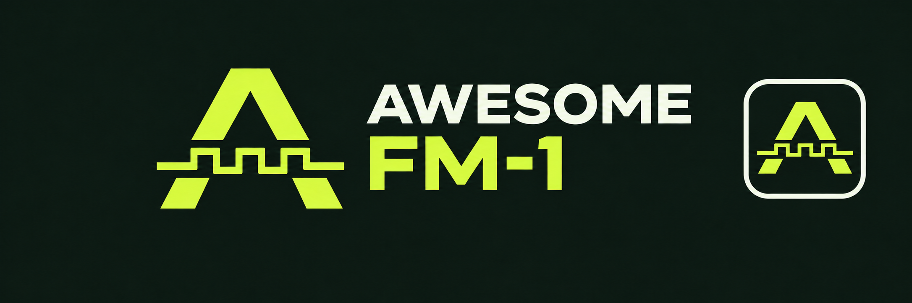

# Awesome FM-1



[](https://github.com/ekim-pl/awesome-fm1/actions/workflows/catalog-ci.yml)
[](https://github.com/ekim-pl/awesome-fm1/actions/workflows/pages.yml)
[](https://ekim-pl.github.io/awesome-fm1/en/)

A community-maintained directory of firmware for the **M-VAVE FM-1**. Discover projects, find their original publishers, and help keep firmware sources accurate and accessible.

A companion project to [FM-1 Flasher](https://github.com/ekim-pl/android-fm1-flasher), the experimental Android firmware browser and USB MIDI flasher. Awesome FM-1 maintains additional firmware sources; multi-source integration in the app is planned, not yet implemented. Visit the [FM-1 Flasher website](https://ekim-pl.github.io/android-fm1-flasher/) for app documentation.

Awesome FM-1 brings together publisher download links, project repositories, release information, and documented compatibility evidence in a consistent catalog. We welcome contributions from firmware authors, musicians, developers, and anyone who discovers a useful FM-1 project.

**Know a firmware project we should include? Open a pull request with its package (`pkg`) URL or project repository URL.** A link and a short description are enough to start a review; a complete catalog entry is welcome too.

This repository stores metadata, not firmware binaries. Packages remain hosted by their publishers. Inclusion identifies a source; it does not certify a firmware package or establish hardware compatibility.

## Explore

- [Firmware directory](#firmware-directory) · [Use the catalogs](#use-the-catalogs)
- [Contributing](#contributing) · [Format and maintenance](#format-and-maintenance)
- [Project website](#project-website) · [Attribution](#attribution)

## Firmware directory

| Project | Description | Publisher | Verification |
| --- | --- | --- | --- |
| [SHRUB](https://shrub.audio/) | Wavetable synthesizer with a browser editor | Xfer Inc. | Package structure checked; hardware compatibility unknown. See [verification evidence](docs/verification.md). |

## Use the catalogs

Choose the combined catalog for a single endpoint, or subscribe to individual publisher catalogs:

- [catalog.json](catalog.json): the combined catalog, generated from `catalogs/*.json`. Recommended single endpoint: <https://raw.githubusercontent.com/ekim-pl/awesome-fm1/main/catalog.json>.
- [catalogs/shrub.json](catalogs/shrub.json): a standalone publisher catalog in the same format. Alternative endpoint: <https://raw.githubusercontent.com/ekim-pl/awesome-fm1/main/catalogs/shrub.json>.

Use the combined catalog **or** selected individual catalogs. Subscribing to both creates overlapping offers; clients must not merge projects by name or device identity.

The planned Android integration keeps **The Firmware Hub enabled by default** and **Awesome FM-1 disabled by default**. Multiple sources and SQLite are not yet implemented in the Android app. This repository provides the catalog foundation.

SHRUB is currently listed with `chip: "unknown"`. Its package passed the Android app's structural parser, but installation, subsequent updates, and old/new flash compatibility have not been tested. Clients must block flashing when compatibility is unknown.

## Third-party discovery catalog

[third-party/composer.json](third-party/composer.json) is an automatically assembled discovery list, separate from the reviewed installation catalog. It combines [2bbb's collection](https://github.com/2bbb/fm1-firmware-collection), the firmware section of [aroum's directory](https://github.com/aroum/fm1-custom-fw), and metadata from [The Firmware Hub](https://thefirmwarehub.com/). The Hub's attribution and license are included in the file. The workflow excludes Hub projects and deduplicates repository, default-branch commit and name; GRUS and JAZZY without Git are retained as separate projects by request. See `aggregation.cleanup` for removals and `aggregation.added_without_git` for entries without a Git link.

Entries are unreviewed and may describe other devices, tools, unavailable projects or works in progress. Missing metadata remains null. It does **not** satisfy the installation catalog schema; do not use it to authorize downloads or flashing. SHRUB also has a separate reviewed entry in `catalog.json`.

The [daily workflow](.github/workflows/third-party.yml) updates the file and commits changes to `main`; it can also be started manually. Locally, run:

```sh
python3 scripts/aggregate_third_party.py --output third-party/composer.json --exclude-hub --unique-code --unique-names
```

The cache under `.cache/fm1-catalog` limits repeated Hub catalog requests to once per 24 hours; retain it across runs as required by the Hub's terms. `--offline` uses cached inputs. The workflow preserves the cache between runs. The file is also published at `https://ekim-pl.github.io/awesome-fm1/third-party/composer.json` with Pages.

## Project website

The GitHub Pages website is available in [English](https://ekim-pl.github.io/awesome-fm1/en/), [Polish](https://ekim-pl.github.io/awesome-fm1/pl/) and [Simplified Chinese](https://ekim-pl.github.io/awesome-fm1/zh-CN/).

Build locally with `python3 scripts/build_site.py`; output goes to `_site/`. Translations are in [website/locales.json](website/locales.json), with shared styling in [website/style.css](website/style.css). The website introduces the project and contribution guidelines without listing individual firmware projects; `catalog.json` remains available as a separate endpoint. The [Pages workflow](.github/workflows/pages.yml) checks PR builds and deploys pushes to `main`. GitHub Pages must use **GitHub Actions** as its source.

## Contributing

Contributions can start with a link; maintainers can help with the catalog details.

### Submit a firmware source

1. Fork this repository and create a branch for your contribution.
2. Choose either submission path below.
3. Open a pull request describing the project and linking to its original publisher. Keep each PR focused on one project or a closely related update.
4. Respond to review questions and make any requested corrections. Maintainers review provenance, metadata, and available evidence before adding a source to the published catalog.

**URL-only submission:** add a short Markdown file under `submissions/`, for example `submissions/my-firmware.md`, using the template below. The directory can be created with your first submission. These files are review proposals and are not imported by the catalog builder. Maintainers can help turn an accepted proposal into a catalog entry; missing package details must be resolved before publication.

```markdown
# Firmware source proposal

- Project name:
- Short description:
- Author / publisher:
- Project website:
- Package URL (pkg) and/or repository URL:
- Release / version (if known):
- FM-1 compatibility evidence (or "unknown"):
- Your relationship to the project (author, user, or other):
- Additional notes (beta status, license, installation docs, etc.):
```

Provide at least one publicly accessible HTTPS package or repository URL. A repository URL is sufficient for proposing a project, even if it does not yet publish a downloadable package. Clearly label projects without installable releases. Do not commit firmware binaries.

**Complete catalog submission:** add or update a publisher file in `catalogs/`, using [catalogs/shrub.json](catalogs/shrub.json) and the [schema](schema/catalog.schema.json) as references. Include verification notes in `docs/` when introducing a package or changing its hash or compatibility claims. Regenerate `catalog.json` and run the checks below before opening your PR.

### Catalog entry requirements

| Field | Contribution guidance |
| --- | --- |
| `id` | Stable, descriptive ID, unique across all component catalogs. Keep it unchanged when updating a release. |
| `name`, `author`, `what` | Project name, credited publisher, and a concise factual description. |
| `pkg` | Publisher-hosted package URL. Prefer an absolute HTTPS URL for a specific release. Disclose mutable download URLs. |
| `repo` | For GitHub projects, use `owner/repository`, not the full URL. Use `null` for direct downloads without a GitHub repository. Include other repository URLs in the proposal or verification notes. |
| `tag`, `asset` | Exact GitHub release tag and numeric release asset ID when applicable; use `null` for direct downloads. |
| `version`, `site`, `beta` | Published version, official project page, and accurate beta status. Do not invent a version or release date. |
| `sha256`, `size` | Lowercase SHA-256 and byte size of the exact package reviewed. Record the download URL and UTC observation time in verification notes. |
| `product` | Identity observed in the package, in the form `FM-1_<number>`. Do not guess it or treat it as a unique project ID. |
| `chip` | Supported hardware only when backed by evidence; otherwise use `unknown`. |

A hash records which bytes were reviewed; it does not prove publisher authenticity or hardware compatibility. Distinguish package parsing from actual installation tests. For hardware test reports, record the firmware hash, device/flash variant, procedure, and observed result. Contributions do not require flashing a device.

### Project guidelines

- **Link to the original source.** Prefer the author's website, repository, and release assets. Explain any alternate host and its relationship to the publisher.
- **Respect authors and distribution rights.** Preserve attribution and relevant license information. A public download link does not grant permission to redistribute the package.
- **Make claims reviewable.** Link supporting release notes or documentation. Mark uncertain details as unknown and disclose beta status and known limitations.
- **Keep updates traceable.** Explain changed URLs, versions, hashes, and compatibility claims. Never replace an expected hash simply to make a failed download pass.
- **Avoid duplicates and promotional copy.** Check existing entries first. Describe what a project does in neutral, useful language.
- **Collaborate respectfully.** Discuss evidence and technical details constructively. Harassment, impersonation, and knowingly misleading submissions are not acceptable.
- **Report stale or incorrect entries.** Open an issue or a focused correction PR with the affected entry, source URL, and evidence. Maintainers may defer or remove entries whose provenance or accuracy cannot be established.

## Format and maintenance

Each catalog has `updated` and `firmwares`, with the existing Hub fields such as `id`, `name`, `repo`, `tag`, `asset`, `pkg`, `sha256`, `product`, `chip`, `site` and `beta`. `repo` may be null for direct publisher downloads. Clients must explicitly support this profile; compatibility with every existing Hub client is not implied.

`pkg` may be an absolute HTTPS URL or a relative path resolved against the source's configured base URL. A Hub subscription must still download from publishers, not the Hub's mirrors, in accordance with [its catalog usage terms](https://thefirmwarehub.com/kb/#catalog).

[schema/catalog.schema.json](schema/catalog.schema.json) documents the profile used by these catalogs. It permits additional upstream fields. [config/app-source-presets.json](config/app-source-presets.json) is a separate integration specification for the app's built-in sources; it is not a firmware catalog and does not change the app by itself.

To edit a catalog:

```sh
python3 -m venv .venv
.venv/bin/python -m pip install -r requirements-dev.txt
.venv/bin/python scripts/catalog.py
.venv/bin/python scripts/catalog.py --check
.venv/bin/python -m unittest discover -s tests -v
```

Edit the individual catalog first, including its actual UTC update time. The builder produces the aggregate deterministically and takes its timestamp from the newest component. CI validates structure, duplicate IDs and aggregate consistency without contacting publishers. It does not verify downloaded firmware or prove hardware compatibility.

New providers, hosts, hashes and compatibility claims require review. Never change an expected hash merely to make a failed download pass. The separate third-party workflow performs scheduled discovery; package validation and catalog signing are not implemented. Published catalogs are currently served over HTTPS without a detached signature.

## Attribution

Catalog format reference: [The Firmware Hub](https://thefirmwarehub.com/). The reviewed installation catalog does not copy the Hub catalog; the separate discovery catalog includes attribution and upstream-derived metadata. Firmware, artwork and publisher descriptions remain their authors' work. Listing a download URL does not grant permission to redistribute its binary. No license is asserted here for third-party firmware.
